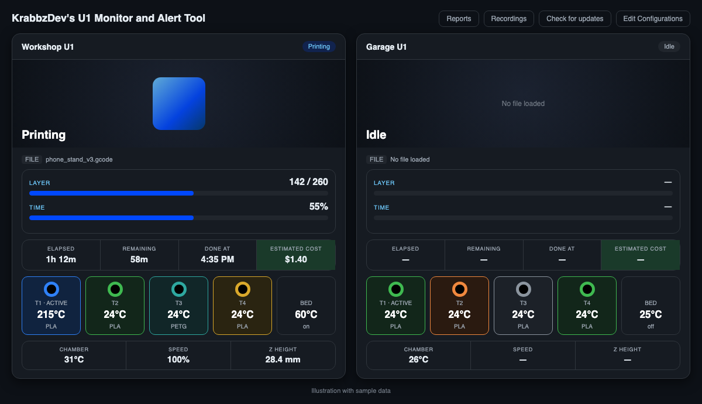

# KrabbzDev's U1 Monitor and Alert Tool

A Windows tray app for Snapmaker U1 printers on your home network. It watches your printers, shows them on a live dashboard, and tells you through Alexa and Windows notifications when a print finishes, fails, or is cancelled.

[](https://github.com/krabbzdev/KrabbzDev-SnapMaker-U1-Announcer/releases/latest/download/U1-Announcer1-Installer.exe)



## Why I built it

I wanted Alexa to tell me when a print finished. I didn't want to keep walking to the printer or checking my phone. This app does that. It also gives you a live dashboard of your printers, which grew out of the same idea.

## What it does

- **Alexa announcements:** Your Echo speaks up when a print finishes, fails, or is cancelled.
- **Live dashboard:** It shows progress, model preview, temperatures, filament, and recent prints. You can open it on the PC or on any phone or computer on your network.
- **Print controls:** You can pause, resume, and adjust speed, flow, fans, and the chamber light from the dashboard. Each control has an on/off switch in Settings.
- **Reports and recordings:** You can see how much you printed over 7 days, 30 days, or all time, and play the timelapse videos saved on your printers.
- **Windows notifications:** These show the printer, the print name, and how long it took.

## Project overview

The tool has two halves in one app:

| Half | What it does |
|---|---|
| **Monitor** | Polls each printer by its local IP address (every 30 seconds by default) and serves a web dashboard on the PC. Open it from the tray icon or from any phone or computer on your network. |
| **Alert** | Sends a Windows notification and, if you set it up, rings a Sinric Pro doorbell so an Alexa routine speaks on your Echo. You choose which outcomes alert you: finished, failed, cancelled. Pauses never alert. |

How the pieces connect:

```
Snapmaker U1 printers  <--- local network (IP address) --->  the app on a Windows PC
                                                                 |-- dashboard (browser, any device on your network)
                                                                 |-- Windows notifications
                                                                 '-- alert helper (Node.js) --> Sinric Pro --> Alexa routine --> Echo
```

- **Runs on:** one Windows PC that stays on and signed in. It lives in the tray, starts with Windows, and updates itself once a day.
- **Settings:** four tabs (Alexa, Printers, Controls, App). They are stored per Windows account and survive updates, reinstalls and uninstalls. You can back them up and restore them from the App tab.
- **Dashboard details:** the tray icon turns blue while printing, green when idle, red on error and grey when a printer is offline. Each toolhead tile shows the loaded filament, each card shows the firmware version, and each print shows an estimated filament cost based on your cost per roll.
- **Troubleshooting:** the app keeps a log (**Settings → App → Open log**), and the [guide](GUIDE.md) has a troubleshooting table for the common problems.

### Things to know

- **Dashboard controls have no password.** Anyone who can open the dashboard can pause, resume, change speed, flow, fans, and the chamber light, so share the address only with people you trust. Cancel is off by default, and every control has its own switch in **Settings → Controls**. Heater temperatures, moving or homing, emergency stop and restarts are left out on purpose.
- **Your Sinric App Key and Secret are stored in plain text** in the settings file, and a settings backup contains them. Keep backups somewhere private.
- **Run the app on one PC only,** or every announcement plays twice.
- **Alexa says a fixed phrase** you choose in its routine, so it can't name the printer. The Windows notification can.
- **The printers don't report remaining filament** on a spool and don't offer a live camera feed, so the dashboard shows neither. Saved timelapse recordings play from the printer.

### What's in this repository

| File | What it is |
|---|---|
| `README.md` | This overview |
| [`OVERVIEW.md`](OVERVIEW.md) | What the tool does, how it works, and every feature |
| [`GUIDE.md`](GUIDE.md) | Full setup guide: static IPs, Sinric Pro and Alexa routines, install, settings reference, backups, troubleshooting |
| `images/` | Screenshots used by the README and guide |
| [Releases](https://github.com/krabbzdev/KrabbzDev-SnapMaker-U1-Announcer/releases) | The installer and the self-update file |

## How the Alexa part works

Alexa can't be told to say a custom sentence on demand, so the app uses a workaround. It uses [Sinric Pro](https://sinric.pro/) to "ring" a virtual Doorbell. An Alexa routine you set up listens for that doorbell and says your phrase. I use two doorbells, one for finished prints and one for failed or cancelled prints.

You need a free Sinric Pro account. It's a separate third-party service, not part of this app. The app runs a small helper that keeps the doorbells connected. The helper runs on Node.js, which the installer includes, so there's nothing extra to install. The dashboard works fine without any of it.

Alexa adds its own line when a doorbell rings ("Someone is at Print Finished"). To hear only your phrase, turn off each doorbell's announcement in the Alexa app (**Devices → the doorbell → gear icon**). The guide has the steps.

The full Sinric Pro walkthrough (devices, App Key and Secret, linking the Alexa skill, building the routines) is in the [guide](https://github.com/krabbzdev/KrabbzDev-SnapMaker-U1-Announcer/blob/main/GUIDE.md).

## What you need

- A Windows PC that stays on and signed in, running the app on **one PC only**, or every announcement plays twice
- A fixed IP address (DHCP reservation) for each printer, so the app doesn't lose them after a router restart
- A free Sinric Pro account and an Echo with the Alexa app (for the announcements). Node.js comes with the installer.

## Install

Download **U1-Announcer1-Installer.exe** from the [releases page](https://github.com/krabbzdev/KrabbzDev-SnapMaker-U1-Announcer/releases/latest). It needs no admin rights, starts with Windows, updates itself once a day, and keeps your settings between updates. The other `.exe` on the releases page is only for self-updating, so you can ignore it.

Full setup steps: [GUIDE.md](https://github.com/krabbzdev/KrabbzDev-SnapMaker-U1-Announcer/blob/main/GUIDE.md)

## Feedback

Use **Send feedback** in the app, or open an [issue](https://github.com/krabbzdev/KrabbzDev-SnapMaker-U1-Announcer/issues).

This repository only holds the downloads and the guide.
